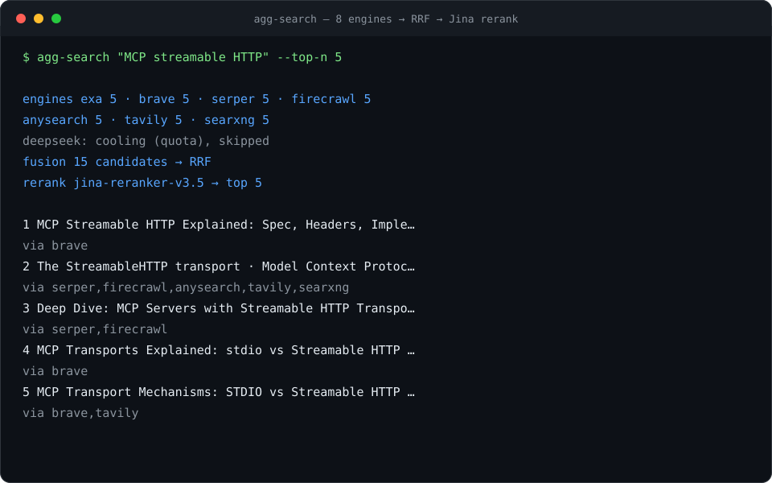
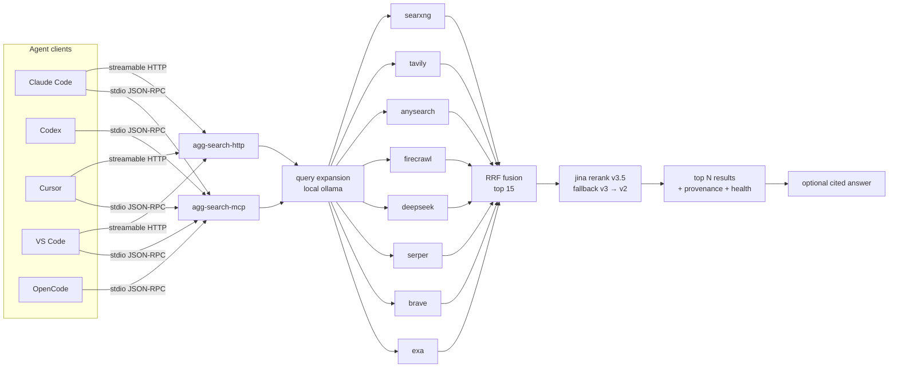

# agg-search

[](https://github.com/TsukimioRinka/agg-search/actions/workflows/tests.yml)
[](https://github.com/TsukimioRinka/agg-search/releases)
[](LICENSE)
[](pyproject.toml)

多引擎并行召回 + RRF 融合 + Jina 精排的搜索工具链：**CLI + MCP server（stdio/HTTP）+ 分层抓取**，宿主机零依赖（纯 Python 标准库）。

A multi-engine search stack for agents: parallel recall across eight engines, RRF fusion, listwise reranking, optional query expansion and cited answers, plus a tiered fetcher. Ships as a CLI and an MCP server — stdio, or streamable HTTP — with standard library only on the host.



*真实一次运行的输出：7 个引擎返回结果，DeepSeek 因余额不足进入冷却、被跳过；空结果不阻塞其余引擎。*

---

## 为什么又一个搜索聚合器

同类项目不少，但多数是「多引擎 + 简单合并」或「零 key 依赖单一索引」。这个项目的差异在五件事：

1. **DeepSeek 搜索/抓取是一等公民** —— 官方 `/v1/tools/search` 自带 `rerank_score`，`/v1/tools/fetch` 服务端取页直接给 Markdown，省掉容器。
2. **抓取是阶梯而不是一个函数** —— DeepSeek Fetch → 静态 → 动态 → 反爬，逐级升级，跑在隔离容器里，宿主机不装浏览器。
3. **排序是两阶段** —— RRF 粗排前 15，再交给 Jina Reranker v3.5 listwise 精排；模型不可用链式回退 v3 → v2，全失败则保留 RRF 顺序，绝不阻塞。
4. **韧性层是显式的** —— 5 分钟结果缓存 + 15 分钟页面缓存、按错误类型分级的冷却（额度 1h / 反爬 10min / 超时 90s）、引擎健康与延迟上报，缺 key 的引擎提前剔除不占线程。
5. **面向 Agent 的协议面** —— MCP `2025-06-18`（含 `outputSchema`/`structuredContent`、tool annotations、版本协商）、stdio 与 streamable HTTP 两种传输、按调用计的硬超时与 `notifications/cancelled`、13 家客户端的配置生成器。

## 架构



## 安装

```bash
# PyPI（0.2.0 起）
uvx --from agg-search agg-search-mcp          # 不落盘，直接跑

# 或者装成常驻命令（6 个入口：3 个 CLI + MCP stdio/HTTP + 安装器）
uv tool install agg-search
```

源码方式：

```bash
git clone https://github.com/TsukimioRinka/agg-search
cd agg-search
uv pip install -e .
# 或者完全不安装：
PYTHONPATH=src python3 -m agg_search.search "query"
```

## 使用

```bash
# 搜索
agg-search "rust async runtime comparison" --top-n 10 --recency month

# 域名过滤：只留 arxiv/.edu，去掉 reddit
agg-search "speculative decoding" --include-domains arxiv.org,.edu \
  --exclude-domains reddit.com

# 机器可读输出（含引擎状态、延迟、冷却与过滤计数）
agg-search "MCP server examples" --json

# RAG-Fusion 查询扩展（需要本地 ollama）
agg-search "vector database tradeoffs" --expand 3

# 带引用的答案段（本地 ollama；--answer deepseek 走 API）
agg-search "what changed in Python 3.13" --answer

# 快速模式：单池扇出，最早两个有结果的引擎就返回
agg-search "breaking news" --fast --budget-secs 20

# 诊断：打印生效配置（密钥只显示布尔值），或列出可用引擎
agg-search --show-config
agg-search --help

# 抓取正文：DeepSeek Fetch 优先，失败落容器阶梯
crawl-fetch --url https://example.com/post --tier auto --out md
```

密钥只从环境变量读（也兼容 `~/.config/agent-env`、`~/.config/ai-keys.env` 的 `KEY=` 行）。缺失的引擎会被跳过，不会让整次搜索失败。常用默认值可用 `AGG_SEARCH_ENGINES`、`AGG_SEARCH_TOP_N`、`AGG_SEARCH_PER_ENGINE`、`AGG_SEARCH_SNIPPET_CHARS`、`AGG_SEARCH_FAST`、`AGG_SEARCH_NO_JINA` 覆盖，命令行显式传参优先。完整变量表见 [docs/environment.md](docs/environment.md)。

## MCP server

暴露两个工具：

| 工具 | 主要参数 | 说明 |
|---|---|---|
| `search` | `query`、`top_n`、`recency`、`engines`、`include_domains`、`exclude_domains`、`snippet_chars`、`expand`、`answer`、`fast`、`budget_secs`、`engine_timeout`、`no_jina` | 并行召回 + RRF + 精排；返回文本内容 + `structuredContent` |
| `fetch` | `urls`、`tier`、`out`、`text_limit`、`allow_private` | 分层抓取正文；每 URL 一条结果 |

协议行为：

- 版本协商：`2025-06-18` / `2025-03-26` / `2024-11-05`，按客户端请求回选支持的版本。
- 工具带 `title`、`annotations`（`readOnlyHint`、`openWorldHint`）和 `outputSchema`；支持结构化输出的客户端直接拿 `structuredContent`，老客户端仍拿文本。
- 每个工具调用有硬墙钟（search 120s / fetch 300s），超时杀进程组；`notifications/cancelled` 同样会中断。
- 工具调用在线程池里跑，`ping`/`tools/list` 不会被慢引擎卡住。
- `search` 在 MCP 下默认 `fast=true`（有限的召回预算），`fast=false` 才等全部引擎。

### 一行接入

```bash
agg-search-install --list                     # 支持 13 家客户端
agg-search-install -c claude-code             # 打印 claude mcp add 命令
agg-search-install -c cursor --write          # 合并进 ~/.cursor/mcp.json（自动备份）
agg-search-install -c vscode --scope project  # 写 .vscode/mcp.json
```

逐客户端的路径、JSON/TOML/YAML 片段与 GUI 环境变量陷阱见 [docs/adapters.md](docs/adapters.md)。

### HTTP 传输

```bash
agg-search-http --host 127.0.0.1 --port 8765 --path /mcp
```

多个客户端共用一个进程（共享缓存与冷却），默认只绑回环并校验 `Host`/`Origin`（防 DNS rebinding 与浏览器跨站请求），端点不带认证——对外必须先套反向代理。协议细节与 nginx 示例见 [docs/http.md](docs/http.md)。

## 同类项目对比

只列能核实的能力，语言一列仅在仓库自述里明确时填写：

| 项目 | 栈 | 它强在哪 | 与本项目的差别 |
|---|---|---|---|
| [search-cli](https://github.com/paperfoot/search-cli) | Rust | 13 个 provider，单一二进制 | 本项目免编译；多容器抓取阶梯与 DeepSeek Fetch 是一等路径 |
| [web-search-mcp](https://github.com/charley-forey/web-search-mcp) | TypeScript | 注入防御（`<untrusted_content>` 包裹 + 隐藏字符剥离）、PDF/RSS/YouTube 抽取、本地语义重排、Recall@5 / MRR@10 评测、MCP resources/prompts | 它的内容抽取与提示注入防护比本项目完整；本项目的差异在 8 引擎并行 + RRF→Jina listwise、DeepSeek Search/Fetch、RAG-Fusion 与容器阶梯。SSRF 防护两边都有，本项目覆盖到抓取前置校验（见 `docs/fetching.md`） |
| [argo](https://github.com/taxueseek/argo) | — | 300+ 来源、18 语言、MCP/CLI | 本项目只做通用网页检索，覆盖面窄；差异在排序链路与成本控制更细 |
| [Tavily MCP](https://github.com/tavily-ai/tavily-mcp) | TypeScript | 托管远端端点、search/extract/map/crawl 四件套、`DEFAULT_PARAMETERS` | 本项目可自带引擎、离线缓存与精排链，不绑定单一供应商 |
| [Brave MCP](https://github.com/brave/brave-search-mcp-server) | TypeScript | 官方索引，HTTP 传输带 Origin/Host 白名单 | 本项目多引擎融合；传输层安全策略参考了它的做法 |
| [Exa MCP](https://github.com/exa-labs/exa-mcp-server) | TypeScript | 托管端点 + OAuth、dynamic highlights | 本项目无托管依赖，密钥和缓存都在本机 |

## 测试

```bash
uv venv && uv pip install -e .
python3 -m unittest discover -s tests -v
```

140+ 个离线测试：域名过滤、RRF、冷却分类、缓存键、SSRF 判定、安装器、MCP 协议面与 stdio/HTTP 端到端（不发起网络请求、不消耗额度）。CI 覆盖 Python 3.10–3.13 + ruff。

## 安全与隐私

- 仓库内不含任何密钥、账号、内网地址；`.env.example` 只有空占位。
- 密钥只在进程环境里读取，不写日志、不落盘；`--show-config` 只输出布尔值。
- 抓取前置 SSRF 校验：仅 http(s)、无 userinfo、私网/回环/链路本地/云元数据地址默认拒绝（`--allow-private` 显式放开）；响应体上限 4 MiB。
- 抓取在容器内执行，宿主机不留浏览器与爬虫依赖。
- 进入模型上下文的页面文本会剥离零宽与双向控制字符（隐藏指令的常见载体），MCP 指令块也声明页面内容为不可信数据。
- HTTP 传输默认回环绑定 + `Host`/`Origin` 白名单，无认证时不得裸奔到公网。

## 文档

| 文档 | 内容 |
|---|---|
| [docs/install.md](docs/install.md) | 安装方式、环境变量全表、冒烟测试 |
| [docs/adapters.md](docs/adapters.md) | 13 家客户端的接入配置 |
| [docs/http.md](docs/http.md) | HTTP 传输、安全模型、反向代理 |
| [docs/fetching.md](docs/fetching.md) | 分层抓取的梯子与容器 |
| [docs/reranking.md](docs/reranking.md) | RRF 与 Jina 精排、参数扫描 |
| [docs/environment.md](docs/environment.md) | 环境变量与计费说明 |

## License

MIT

<!-- mcp-name: io.github.TsukimioRinka/agg-search -->
