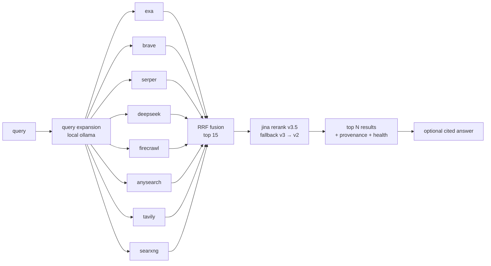

# agg-search

多引擎并行召回 + RRF 融合 + Jina 精排的搜索工具链：**CLI + MCP server + 分层抓取**，宿主机零依赖（纯 Python 标准库）。

A multi-engine search stack for agents: parallel recall across eight engines, RRF fusion, listwise reranking, optional query expansion and cited answers, plus a tiered fetcher. Ships as a CLI and an MCP server. Standard library only on the host.

---

## 为什么又一个搜索聚合器

同类项目不少，但多数是「多引擎 + 简单合并」或「零 key 依赖单一索引」。这个项目的差异在四件事：

1. **DeepSeek 搜索/抓取是一等公民** —— 官方 `/v1/tools/search` 自带 `rerank_score`，`/v1/tools/fetch` 服务端取页直接给 Markdown，省掉容器。
2. **抓取是阶梯而不是一个函数** —— DeepSeek Fetch → 静态 → 动态 → 反爬，逐级升级，跑在隔离容器里，宿主机不装浏览器。
3. **排序是两阶段** —— RRF 粗排前 15，再交给 Jina Reranker v3.5 listwise 精排；模型不可用链式回退 v3 → v2，全失败则保留 RRF 顺序，绝不阻塞。
4. **韧性层是显式的** —— 5 分钟磁盘缓存、按错误类型分级的冷却（额度 1h / 反爬 10min / 超时 90s）、引擎健康上报，缺 key 的引擎提前剔除不占线程。

## 架构



## 安装

```bash
git clone https://github.com/TsukimioRinka/agg-search
cd agg-search
python3 -m pip install -e .
```

只想要脚本、不想装包也行：`PYTHONPATH=src python3 -m agg_search.search "query"`。

## 使用

```bash
# 搜索
agg-search "rust async runtime comparison" --top-n 10 --recency month

# 机器可读输出
agg-search "MCP server examples" --json

# RAG-Fusion 查询扩展（需要本地 ollama）
agg-search "vector database tradeoffs" --expand 3

# 带引用的答案段（本地 ollama；--answer deepseek 走 API）
agg-search "what changed in Python 3.13" --answer

# 快速模式：单池扇出，最早两个有结果的引擎就返回
agg-search "breaking news" --fast

# 抓取正文：DeepSeek Fetch 优先，失败落容器阶梯
crawl-fetch --url https://example.com/post --tier auto --out md
```

密钥只从环境变量读（也兼容 `~/.config/agent-env`、`~/.config/ai-keys.env` 的 `KEY=` 行）。缺失的引擎会被跳过，不会让整次搜索失败。完整变量表见 [docs/environment.md](docs/environment.md)。

## MCP server

```json
{
  "mcpServers": {
    "agg-search": {
      "command": "agg-search-mcp",
      "env": { "BRAVE_API_KEY": "...", "EXA_API_KEY": "..." }
    }
  }
}
```

暴露两个工具：

| 工具 | 参数 | 说明 |
|---|---|---|
| `search` | `query`（必填）、`top_n`、`recency`、`engines`、`expand`、`answer`、`fast`、`no_jina` | 并行召回 + RRF + 精排，返回 JSON |
| `fetch` | `urls`（必填）、`tier`、`out`、`text_limit` | 分层抓取正文 |

服务用换行分隔的 JSON-RPC 2.0，`initialize` / `tools/list` / `tools/call` / `ping` 都已实现，可直接挂到 MCP 客户端。

## 同类项目对比

只列能核实的能力，语言一列仅在仓库自述里明确时填写：

| 项目 | 栈 | 它强在哪 | 与本项目的差别 |
|---|---|---|---|
| [search-cli](https://github.com/paperfoot/search-cli) | Rust | 13 个 provider，单一二进制 | 本项目免编译；多容器抓取阶梯与 DeepSeek Fetch 是一等路径 |
| [web-search-mcp](https://github.com/charley-forey/web-search-mcp) | TypeScript | SSRF 安全抓取、注入防御（`<untrusted_content>` 包裹 + 隐藏字符剥离）、PDF/RSS/YouTube 抽取、本地语义重排、Recall@5 / MRR@10 评测、MCP resources/prompts | 它的抓取安全与内容抽取比本项目完整；本项目的差异在 8 引擎并行 + RRF→Jina listwise 两阶段排序、DeepSeek Search/Fetch、RAG-Fusion 扩展与容器化的静态→动态→反爬阶梯 |
| [argo](https://github.com/taxueseek/argo) | — | 300+ 来源、18 语言、MCP/CLI | 本项目只做通用网页检索，覆盖面窄；差异在排序链路与成本控制更细 |
| [websearch-mcpserver](https://github.com/daidaiJ/websearch-mcpserver) | Go | 零 key 可跑、多引擎 + 学术源 | 本项目按 key 选择性启用引擎，不承诺零 key |
| [free-search-api](https://github.com/Ethos6/free-search-api) | — | 自托管、无 key、Tavily 兼容端点 | 本项目是客户端编排层，不提供兼容 API |

## 测试

```bash
PYTHONPATH=src python3 -m unittest discover -s tests -v
```

离线测试只覆盖纯函数（域名归并、去重、RRF、冷却分类、缓存键），不发起网络请求、不消耗额度。

## 安全与隐私

- 仓库内不含任何密钥、账号、内网地址；`.env.example` 只有空占位。
- 密钥只在进程环境里读取，不写日志、不落盘。
- 抓取在容器内执行，宿主机不留浏览器与爬虫依赖。

## License

MIT
